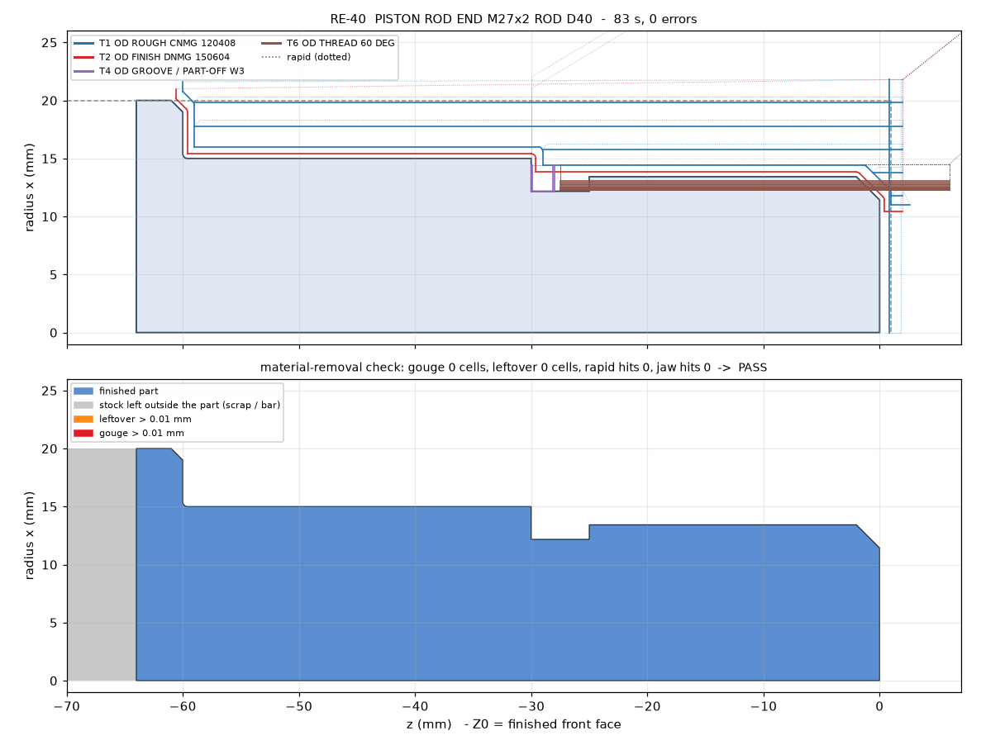
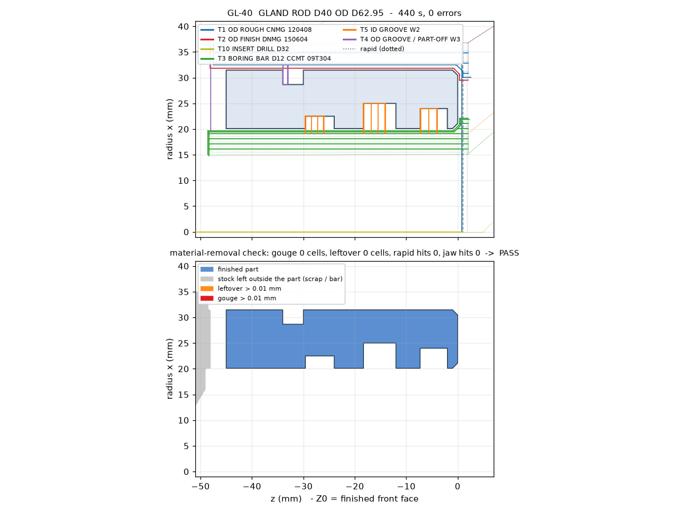
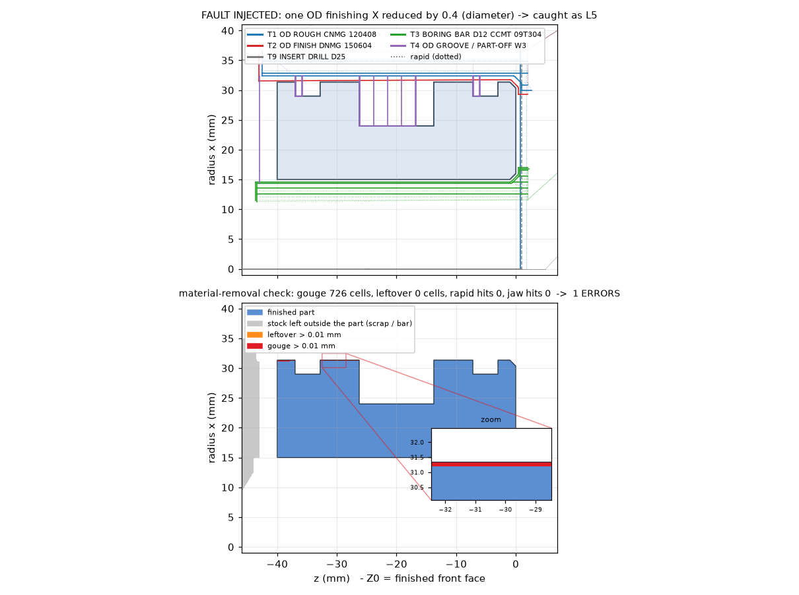

# CNC part-family generator for hydraulic-cylinder parts

[](https://github.com/chad416/cnc-part-family-generator/actions/workflows/ci.yml)

A shop that makes hydraulic cylinders to order turns many small batches of the same few parts: piston-rod ends, pistons and glands. The variants differ only in size, yet each one usually gets a hand-written lathe program.

This project turns **one row of a parameter table into a complete 2-axis lathe program**, and then **checks that program by reading it back**. The check does not trust the generator. It parses the G-code text, rebuilds the tool motion (canned cycles included) and runs a material-removal simulation.

The simulation catches:
- gouges;
- material left on the part;
- rapid moves into stock;
- crashes into the chuck jaws;
- spindle-mode mistakes, such as G96 while threading or drilling, or no speed clamp;
- a thread that is too shallow or runs past its relief groove.

```
data/piston.csv  ->  plan (face, rough, finish, drill, bore, grooves, thread, part-off)
                 ->  FANUC-style (explicit, or G71/G70/G76 cycles) or Sinumerik-style text
                 ->  read the text back -> simulate material removal -> PASS / list of errors + cycle time
```

**Everything here is simulated.** No real machine, control or part was used. The part sizes and cutting data are illustrative. See [Limits](#limits).



## Results

The examples cover 3 part families × 3 sizes × 3 output styles, which makes 27 programs. All are generated, read back and checked: [`examples/summary.md`](examples/summary.md).

| Part | What it is | Ops | Tool changes | Cycle time |
|---|---|---|---:|---:|
| RE-25 / RE-40 / RE-56 | Piston-rod end: M16x1.5 / M27x2 / M42x3 thread, relief groove, piston seat, shoulder chamfer | face, OD rough + finish, relief groove, thread | 4 | 40 / 83 / 156 s |
| PI-40 / PI-63 / PI-80 | Piston for a 40 / 63 / 80 mm bore: seal groove, 2 guide-ring grooves, rod bore | face, OD, drill, bore, 3 grooves, part-off | 5 | 150 / 308 / 558 s |
| GL-25 / GL-40 / GL-56 | Gland for a 25 / 40 / 56 mm rod: wiper, rod-seal and guide grooves inside, O-ring groove outside | face, OD, drill, bore, 3 ID grooves, 1 OD groove, part-off | 6 | 194 / 440 / 871 s |

- **Every one of the 27 programs passes every check.** 0 gouge cells, 0 leftover cells (tolerance 0.01 mm), 0 rapid hits, 0 jaw hits.
- **The 3 output styles give the same motion.** For each part, the canned-cycle program (78 lines for RE-40), the explicit FANUC program (153 lines) and the Sinumerik program (151 lines) produce the same moves within 0.002 mm and the same cycle time.
- **Fault injection: 13 of 13 deliberate faults are caught**, each by the rule meant for it. See [`docs/fault_injection.md`](docs/fault_injection.md). For example:
  - a finishing pass 0.2 mm too deep → gouge (L5);
  - the G70 finishing call deleted → leftover (L6);
  - the part-off moved 12 mm towards the chuck → jaw hit (L4);
  - G96 left on for G76 → L2;
  - the G76 minor diameter 0.4 mm too large → thread depth (L13).
- **Tests:** 23 pytest tests, about 6 s.
  - The finishing path stays exactly one nose radius from the profile (to 1e-9 mm).
  - ISO 68-1 thread geometry.
  - Cycle time checked against a hand calculation.
  - Constant-surface-speed clamping.
  - The FANUC and Sinumerik readers agree.
  - Row validation rejects 7 kinds of bad input.
  - All 27 programs pass, and all 3 output styles give the same motion.
  - The fault injections.

The cycle times are from solid bar, using the generic cutting data in `data/tools.json`. Glands and pistons would normally start from tube or a pre-drilled blank, which removes most of the boring time.



*Top panel: every move, coloured by tool; rapids are dotted. Bottom panel: the simulated material after the last move. Blue is the finished part; red would be a gouge; orange would be leftover.*



*A program that passes every check, with one finishing coordinate changed by 0.4 mm (diameter). The verifier reports gouge rule L5 at that line. The inset shows the 0.2 mm cut into the part.*

## What a program looks like

Excerpt from `examples/programs/fanuc_cycles/RE-40.nc`. The G71 contour is the finishing tool's nose-centre path, so the arcs around corners are the 0.4 mm nose radius:

```
T0101 (OD ROUGH CNMG 120408)
G50 S3500
G96 S170 M3
G0 X43.600 Z2.000 M8
G71 U2.000 R0.500
G71 P100 Q200 U1.200 W0.600 F0.25
N100 G0 X20.850
G1 X20.850 Z0.400 F0.12
G1 X22.850 Z0.400
G3 X23.416 Z0.283 R0.400
G1 X27.416 Z-1.717
...
N200 G1 X42.000 Z-60.600
(OD FINISH)
...
T0202 (OD FINISH DNMG 150604)
G50 S3500
G96 S212 M3
G0 X43.600 Z2.000 M8
G70 P100 Q200
...
T0606 (OD THREAD 60 DEG)
G97 S1002 M3
G0 X29.000 Z6.000 M8
G76 P010060 Q50 R0.020
G76 X24.546 Z-27.500 P1227 Q400 F2.000
```

The Sinumerik version of the same part uses `LIMS=`, `G95`, `DIAMON`, `G3 ... CR=0.400` and `G33 Z.. K2.000`.

## How it works

1. **Part families** (`cncgen/parts.py`). One CSV row gives the profile, grooves and thread. The row is checked against the tool library before any program is written. The checks:
   - groove width against the tool width;
   - groove depth against the tool's reach;
   - thread chamfer against the thread depth;
   - a drill that fits between the boring bar's minimum and the bore;
   - wall left under the grooves;
   - spacing between grooves.
2. **Planning** (`cncgen/planner.py`).
   - The finishing path is the profile offset by the nose radius, with arcs at outside corners and trimmed inside corners (`geometry.offset_profile`).
   - Roughing follows the G71 type-I model: horizontal passes, a 45° retract, then one pass along the contour shifted by the finishing allowance. The finishing tool's path is shifted by `allowance + (r_rough − r_finish)`, so the larger roughing nose stays 0.2 mm clear everywhere.
   - Grooves are plunge-roughed with 0.1 mm left on the walls and floor, then finished down one wall, along the floor and up the other.
   - Threads use d1·√n infeed per pass, a 0.02 mm finishing allowance and one spring pass.
3. **Output** (`cncgen/post.py`). There are three styles:
   - FANUC-style with explicit moves (G0/G1/G2/G3/G32);
   - FANUC-style with canned cycles (G71/G70/G76);
   - Sinumerik-style (explicit moves, `CR=`, `G33`, `LIMS=`).
4. **Read-back** (`cncgen/interp.py`). Parses either style and keeps the modal state (motion, feed, G96/G97, speed clamp, spindle, tool). G71, G70 and G76 are expanded with the same cycle model ([SPEC §5](docs/SPEC.md)).
5. **Verification** (`cncgen/verify.py`).
   - The stock is a 0.05 mm grid of the half-section.
   - Each move removes what its tool sweeps:
     - turning and boring tools: the nose disk plus a cutting-edge strip;
     - grooving tools: a rectangle;
     - drills: a cylinder with a 118° point.
   - A signed-distance field of the finished part decides gouge and leftover.
   - Rapids are swept against the remaining material.
   - The chuck jaws are a ring behind the stock.
   - Spindle and thread rules are checked on the parsed program.
6. **Cycle time** (`cncgen/timing.py`).
   - Feed moves are integrated along the path. Under G96 the rpm follows the diameter (1000·Vc/πD) up to the G50/LIMS clamp.
   - Rapids use the slower of the X and Z axes.
   - Each tool change adds a fixed time.

While I built this, the checks flagged 4 problems. Each is fixed at its cause, not hidden by a tolerance:
1. **Verifier tool model.** The turning insert was a bare nose disk. It left a ring of stock that a real insert's cutting edge removes, and it raised false rapid hits. The insert is now the nose disk plus its edge strip.
2. **Inside corners.** A round nose cannot cut a sharp inside corner, which showed up as 0.075 mm of leftover at the rod shoulder. The part definition now states the R0.4 inside corner the drawing has to allow.
3. **Reader bug.** The reader applied the G71 roughing feed (0.25) to the G70 finishing contour instead of the contour's own feed (0.12).
4. **Thread rounding.** G76 carries the thread depth in whole microns, so the explicit program made one extra 0.0001 mm pass. Both outputs now use the same rounded depth.

## Run it

```bash
pip install -r requirements.txt
python -m pytest
python -m cncgen build            # writes examples/ and docs/img/
python -m cncgen build --check    # fails if the output differs from the committed files (CI)
python -m cncgen inject           # fault injection -> docs/fault_injection.md
python -m cncgen verify examples/programs/sinumerik/PI-63.mpf --dialect sinumerik --id PI-63 --png check.png
```

To add a size, add a row to `data/rod_end.csv`, `data/piston.csv` or `data/gland.csv`. A row that cannot be made is rejected with the reason.

## Limits

- **Not proven on a machine.** The output follows common FANUC and Sinumerik programming conventions. Real post-processors differ per machine and control option. Feeds and speeds are generic.
- **Cycle model.**
  - G71 is modelled as horizontal passes plus one pass along the shifted contour. Controls differ in this final pass and in the retract.
  - G76 is modelled with radial infeed. A real G76 uses flank infeed, which only moves the start of each pass inside the run-in.
  - The verifier expands the cycles with the same model the planner uses. The independent check is the material simulation, not the cycle expansion.
- **Programmed point is the nose centre**, with no G41/G42. Many shops program the imaginary tip with G42 instead. That would be a change in the output stage only.
- **Tool model.**
  - Turning and boring tools are the nose disk plus a 2·r cutting-edge strip. The holder, the turret and the boring-bar shank are not modelled.
  - Grooving-insert corners are taken as sharp.
  - The chuck is a ring of jaws, 20 mm high.
- **Inside corners.** Inside corners on the turned profile come out at the finishing nose radius (R0.4), so the drawing must allow that. Groove corners are sharp.
- **Op 1 only.** Back chamfers after the part-off (op 2) are not generated.
- **The thread flanks are not simulated.** The thread is checked analytically instead: ISO 68-1 depth, end inside the relief, run-in ≥ 2·P, lead = pitch.
- **Grid resolution.** The grid samples the section every 0.05 mm, with a 0.01 mm tolerance at the sample points. A defect smaller than the grid spacing can fall between samples.
- **The groove sizes in the CSVs are illustrative.** They are not taken from a seal maker's catalogue.

## Repository

```
cncgen/        parts, planner, cycles, post, interp (reader), verify, timing, plot, inject, cli
data/          rod_end.csv, piston.csv, gland.csv, tools.json, machine.json
examples/      generated programs (fanuc, fanuc_cycles, sinumerik) and summary.md/.csv
docs/          SPEC.md, traceability.md, fault_injection.md, img/
tests/         pytest
```

MIT licence.
